<p align="center">
  
</p>

<h1 align="center">🛡 DIVISION T82</h1>

<p align="center">
  <em>Plataforma <strong>local-first</strong> de auditoría de postura de seguridad.<br/>
  Read-only · evidencia trazable · puntuación explicable · cero telemetría.</em>
</p>

<p align="center">
  <strong>By: Ramón Taboada Olivella — RTO Studio</strong>
</p>

<p align="center">
  <a href="#-instalación-en-30-segundos"></a>
  
  
  
  <a href="LICENSE"></a>
  
</p>

---

## 📸 Vistazo rápido

| Resumen de seguridad | Evaluación de seguridad |
|---|---|
| 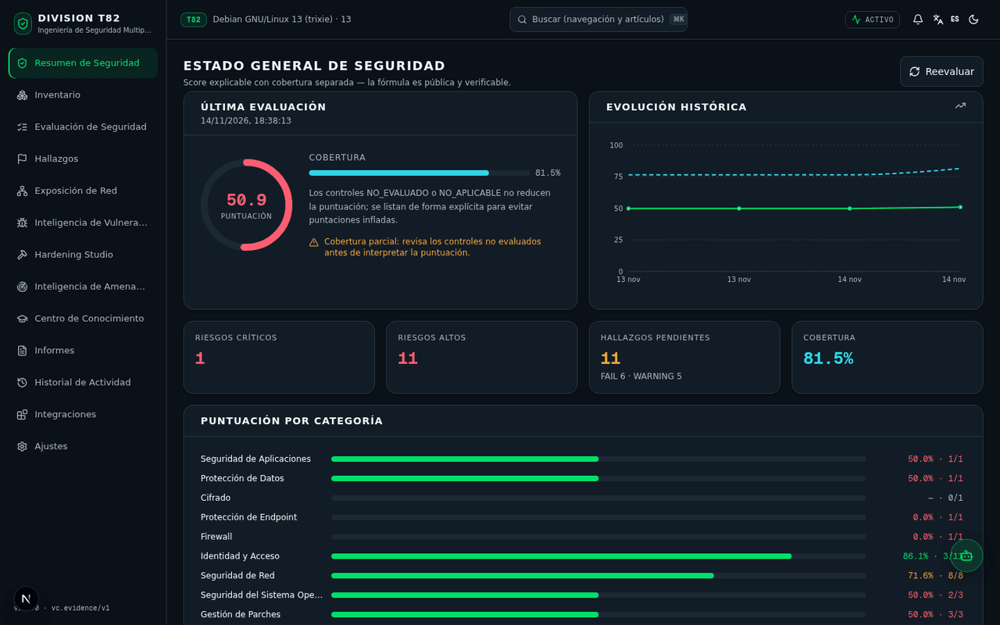 | 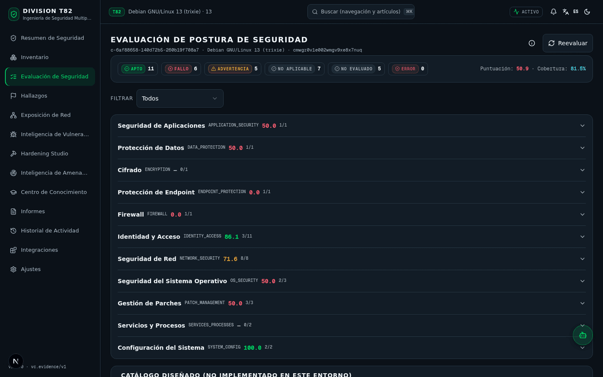 |

| Inteligencia de vulnerabilidades | Informes + Centro de descargas |
|---|---|
| 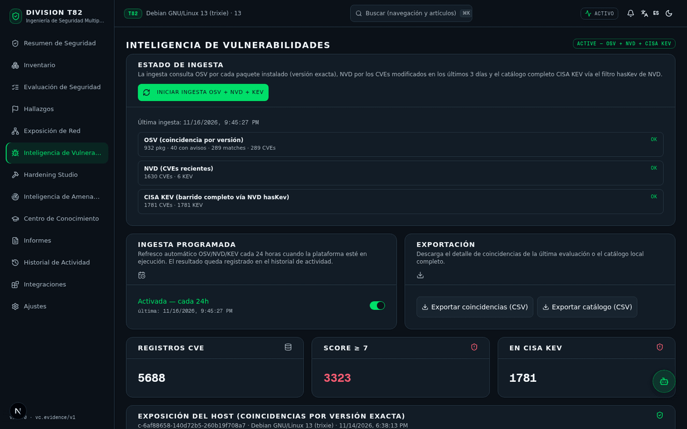 | 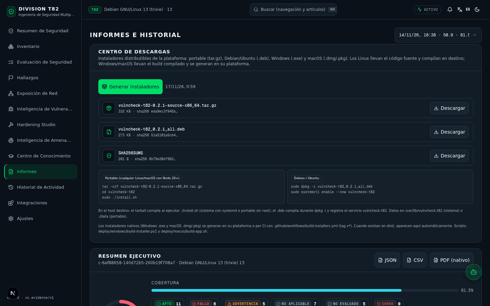 |

<details>
<summary><strong>🖼 Más capturas</strong> — Inventario · Hallazgos · Hardening Studio · Conocimiento · Integraciones MCP · Asistente IA</summary>

| Inventario | Hallazgos |
|---|---|
| 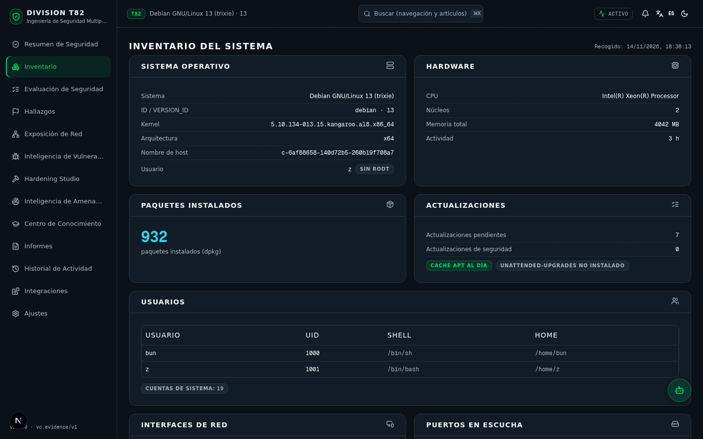 | 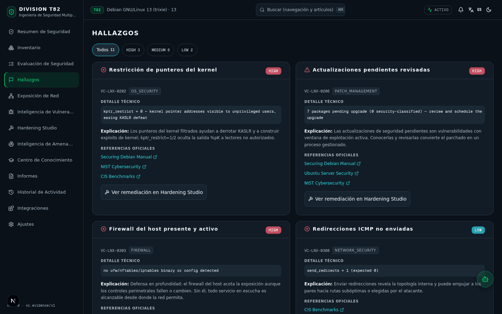 |

| Hardening Studio | Centro de Conocimiento |
|---|---|
| 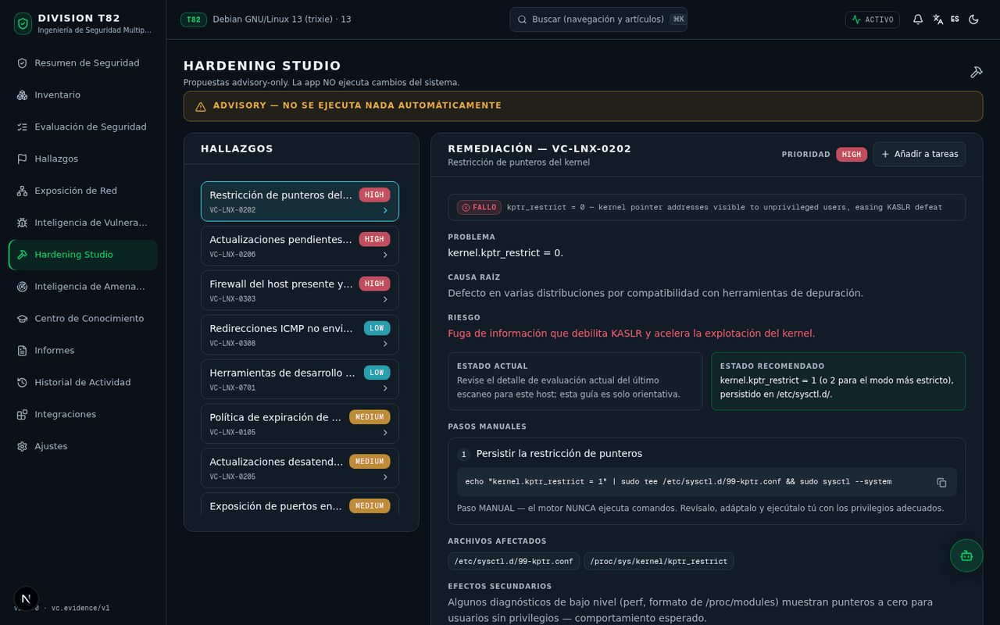 | 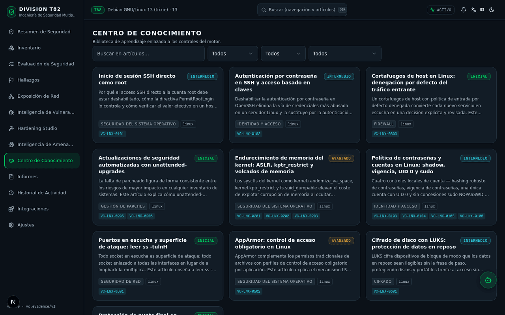 |

| Integraciones (MCP/RAG) | Asistente T82 en acción |
|---|---|
| 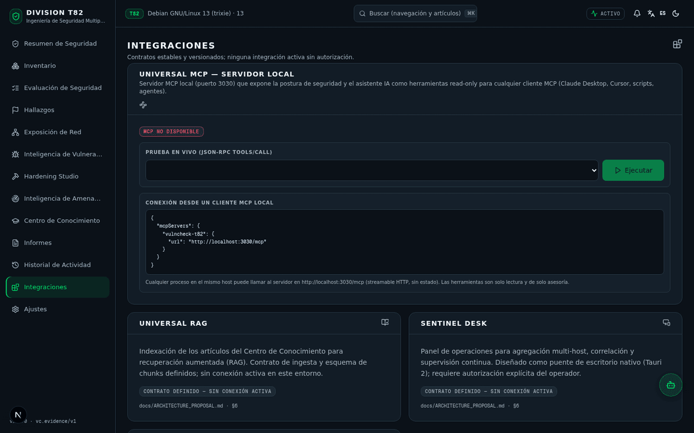 | 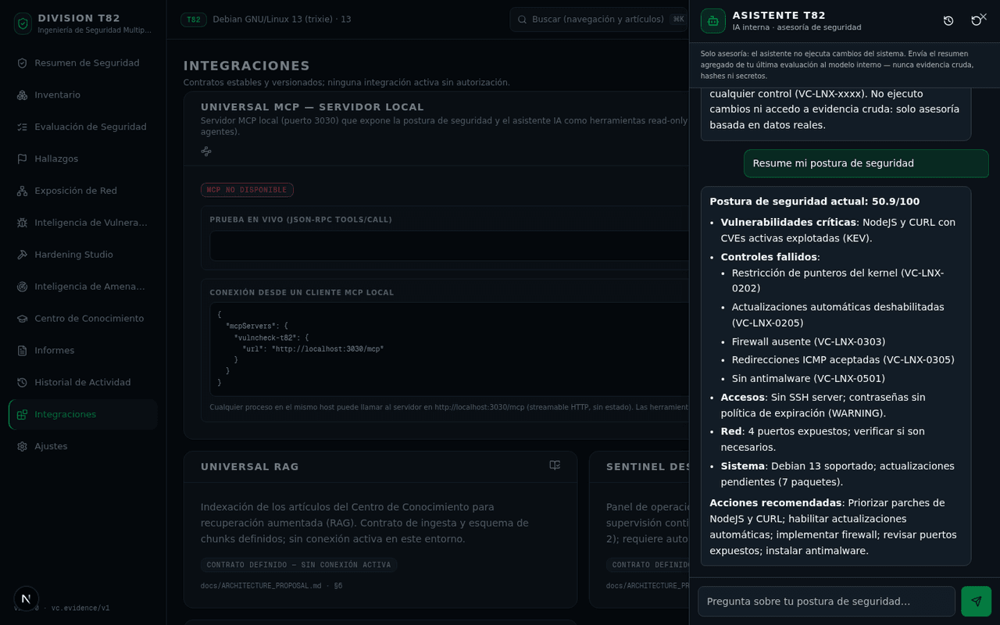 |

</details>

<p align="center"></p>

## 🎯 ¿Qué es?

**DIVISION T82** audita tu máquina **sin tocar nada**: el motor recorre el
sistema en modo **solo lectura**, evalúa **20 controles de seguridad** (catálogo
`VC-LNX-xxxx`), produce una **puntuación 0–100 con fórmula pública**, y adjunta
**evidencia cruda** (`vc_evidence/v1`) a cada resultado — nada de cajas negras.

- 🧮 **Puntuación explicable** — pesos `CRITICAL=10 · HIGH=8 · MEDIUM=5 · LOW=3 · INFO=1`,
  créditos `PASS=1.0 · WARNING=0.5 · FAIL=0.0`, y la **cobertura se informa aparte**
  (los controles no evaluados NO penalizan: no hay puntuaciones infladas).
- 🔎 **Evidencia trazable** — cada control enlaza al dato crudo que lo justifica.
- 🛰 **Inteligencia OSV / NVD / CISA-KEV** — ingesta on-demand desde la UI, priorizando CVE explotadas activamente (KEV).
- 🤖 **Asistente IA interno** — grounded en TU última evaluación, solo asesoría, nunca ejecuta cambios.
- 🔌 **Servidor MCP local** — expone la postura como herramientas read-only para Claude Desktop, Cursor o scripts.
- 📄 **Informes** — exportables con resumen ejecutivo, cobertura, hallazgos y evidencia referenciada.
- 🇪🇸🇬🇧 **Bilingüe** (ES/EN) · 🌗 tema claro/oscuro · 🧱 SQLite local, sin servicios externos salvo las fuentes de inteligencia que TÚ activas.

## 🚀 Instalación en 30 segundos

> Todos los instaladores se generan automáticamente por CI y quedan en
> [**Releases**](../../releases). También puedes generarlos desde la propia app:
> **Informes → Centro de descargas**.

| Plataforma | Instalador | Comando |
|---|---|---|
| 🐧 **Debian / Ubuntu** | `vulncheck-t82_<v>_all.deb` | `sudo dpkg -i vulncheck-t82_*.deb` |
| 🐧 **Linux / macOS portable** | `vulncheck-t82-<v>-source-<arch>.tar.gz` | `tar -xzf vulncheck-t82-*.tar.gz && cd vulncheck-t82 && sudo ./install.sh` |
| 🪟 **Windows 10/11 (x64)** | `vulncheck-t82-<v>-win64-setup.exe` | doble clic (administra el servicio `VulncheckT82`) |
| 🍎 **macOS (portable)** | `vulncheck-t82-<v>-macos-<arch>.dmg` | abrir el .dmg y copiar la .app a Aplicaciones |
| 🍎 **macOS (sistema)** | `vulncheck-t82-<v>-macos-<arch>.pkg` | `sudo installer -pkg vulncheck-t82-*.pkg -target /` |

<details>
<summary><strong>🔨 Compilar desde fuente</strong> (Node 20+, 2–4 min)</summary>

```bash
git clone https://github.com/TU-USUARIO/vulncheck-t82.git
cd vulncheck-t82
npm ci && npx prisma generate && npx next build
DATABASE_URL=file:./data/vulncheck.db node .next/standalone/server.js
# → http://localhost:3000
```

Instaladores nativos: `deploy/windows/build-installer.ps1` (Windows + NSIS),
`deploy/macos/build-app.sh` (macOS), `deploy/scripts/make-release.sh` (Linux).
Rutas completas en [`deploy/README.md`](deploy/README.md).

</details>

## 📚 Documentación

| | Documento | Contenido |
|---|---|---|
| 📘 | [**Especificación de arquitectura**](docs/ARCHITECTURE_PROPOSAL.md) | Diseño del motor, catálogo de controles, scoring y evidencia |
| 📡 | [**Contrato de API**](docs/API_CONTRACT.md) | Endpoints, esquemas y semántica de errores |
| 🛠 | [**How-To**](docs/HOW-TO.md) | Guías paso a paso: primera auditoría, informes, MCP, backups |
| 🌐 | [**Wiki**](docs/WIKI.md) | Índice temático + glosario (CVE, KEV, cobertura, MCP…) |
| 🗺 | [**Roadmap de implementación**](docs/IMPLEMENTATION_ROADMAP.md) | Fases y estado del catálogo diseñado |
| 🧩 | [**Matriz de compatibilidad**](docs/PLATFORM_COMPATIBILITY_MATRIX.md) | Linux / Windows / macOS — qué evalúa cada plataforma hoy |
| 📦 | [**Guía de despliegue**](deploy/README.md) | Docker, systemd, .deb, instaladores nativos de los 3 SO |
| 🔏 | [**Seguridad**](SECURITY.md) | Reportar vulnerabilidades y política de divulgación |
| 📋 | [**Changelog**](CHANGELOG.md) | Historial de versiones |

## 🏗 Arquitectura en 20 segundos

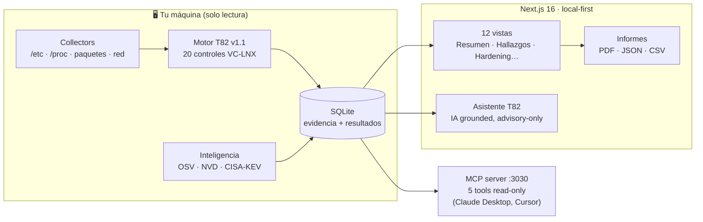

## 🔌 Conecta tu cliente MCP

```jsonc
// Claude Desktop → claude_desktop_config.json
{ "mcpServers": { "vulncheck-t82": { "url": "http://localhost:3030/mcp" } } }
```

Herramientas read-only: `t82_latest_posture` · `t82_control_search` ·
`t82_top_cves` · `t82_knowledge_search` · `t82_ask` — detalle en el
[How-To MCP](docs/HOW-TO.md#6-conecta-un-cliente-mcp-claude-desktop-cursor).

## 🧭 Mapa del repositorio

```text
├─ src/app/api/          16 endpoints (overview, scans, vuln-intel, assistant…)
├─ src/components/t82/   Vistas y tarjetas de la plataforma
├─ src/lib/engine/       Motor: collectors, rules/linux, scoring público
├─ mini-services/
│  ├─ mcp-server/        MCP read-only en :3030 (streamable HTTP)
├─ prisma/schema.prisma  15 modelos (Host, ScanJob, Evidence, Finding…)
├─ deploy/
│  ├─ install.sh         Instalador Linux (systemd o portable)
│  ├─ scripts/           make-release.sh · make-deb.sh
│  ├─ windows/           installer.nsi (NSIS) + servicio WinSW + build.ps1
│  ├─ macos/             build-app.sh (.dmg) · build-pkg.sh (.pkg)
│  └─ tauri/             Shell de escritorio Tauri 2 (opcional)
├─ docs/                 Specs · API · How-To · Wiki · Roadmap
└─ .github/workflows/    CI que construye los instaladores de los 3 SO
```

## 🛡 Postura ética

- **Solo lectura**: el motor nunca modifica el sistema — ni un `chmod`.
- **Advisory-only**: la IA y el MCP aconsejan; nada se ejecuta sin ti.
- **Sin telemetría**: los datos viven en un SQLite local. Las únicas llamadas
  externas son las fuentes OSV/NVD/KEV **cuando tú las activas**.
- **Honestidad de cobertura**: lo no evaluado se lista — jamás se infla la nota.

## 📄 Autoría

<div align="center">


**Creado por Ramón Taboada Olivella — RTO Studio**

<em>DIVISION T82 · Ingeniería de Seguridad Multiplicidad · local-first o nada</em>

</div>

## 📜 Licencia

Proyecto open source bajo licencia **MIT** — libre para usar, estudiar,
modificar y redistribuir. Detalles en el archivo [LICENSE](LICENSE).
